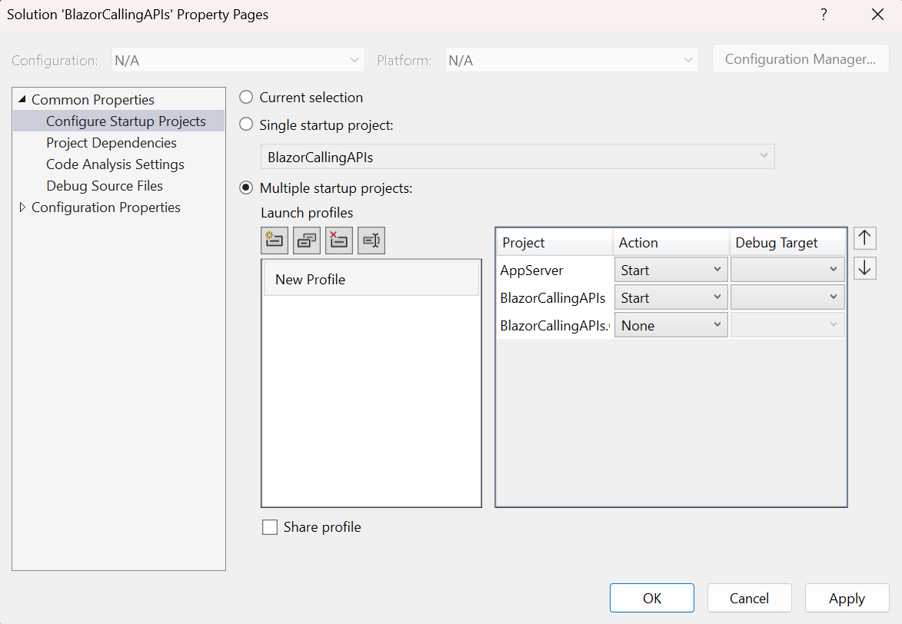

# Calling Web APIs

## Creating the Solution

1. Open Visual Studio
2. Click on Create a new project
3. Select Blazor Web App
4. Click Next
5. Enter the project name: `BlazorCallingAPIs`
6. Click Next
7. Use the following options:
   - Framework: .NET 10.0
   - Authentication Type: None
   - Configure for HTTPS: Checked
   - Interactive render mode: Auto (Server and WebAssembly)
   - Interactivity location: Per page/component
   - Include sample pages: Checked
8. Click Create

## Adding an AppServer project

1. Right-click on the solution
2. Click on Add > New Project
3. Select ASP.NET Core Web API
4. Click Next
5. Enter the project name: `AppServer`
6. Click Next
7. Use the following options:
   - Target Framework: .NET 10.0
   - Authentication Type: None
   - Configure for HTTPS: Checked
   - Enable OpenAPI support: Unchecked
   - Use controllers: Checked
8. Click Create
9. Run the AppServer project from Visual Studio
10. Make note of the port number: `https://localhost:????` (you can also find it in the `https` profile in the `Properties/launchSettings.json` file of the AppServer project)

## Examine the WeatherForecast class

1. Open the `WeatherForecast.cs` file in the `AppServer` project
2. Notice the class has the same properties as the `WeatherForecast` class in the Blazor project
3. This class will be used to return data from the Web API

## Examine the WeatherForecastController

1. Open the `WeatherForecastController.cs` file in the `AppServer` project
2. Notice the `Get` method returns an array of `WeatherForecast` objects
3. This method will be used to return data from the Web API

## Configure Startup Projects

1. Right-click on the solution
2. Click on Configure Startup Projects
3. Select Multiple startup projects
4. Set the Action for the `BlazorCallingAPIs` project to Start
5. Set the Action for the `AppServer` project to Start
6. Click OK



## Using the API in the Blazor project

1. Open the `Weather.razor` file in the `BlazorCallingAPIs` project
2. Add a `using` statement for the `System.Net.Http.Headers` namespace below the `@page` directive

```html
@using System.Net.Http.Headers
```

3. Change the `OnInitializedAsync` method in the `Weather.razor` page to use the Web API

```csharp
    protected override async Task OnInitializedAsync()
    {
        var httpClient = new HttpClient();
        httpClient.DefaultRequestHeaders.Authorization = new AuthenticationHeaderValue("Bearer", "MyBearerTokenValue");
        forecasts = await httpClient.GetFromJsonAsync<WeatherForecast[]>("https://localhost:7285/weatherforecast");
    }
```

> ⚠️ Change the port from `7285` to the port of _your_ AppServer project

4. Run the application
5. Navigate to the `Weather` page
6. You will see the weather forecast data loaded from the Web API

## Using the API from a WebAssembly Page

1. Add a new `ClientWeather.razor` file to the `Pages` folder in the _client_ project
2. Copy the contents of the `Weather.razor` file to the new file
3. Change the `ClientWeather.razor` page to use interactive WebAssembly rendering

```html
@rendermode InteractiveWebAssembly
```

4. Change the title of the page to `Client Weather`

```html
<PageTitle>Client Weather</PageTitle>

<h3>Client Weather</h3>
```

5. Add the new page to the navigation menu by editing the `NavMenu.razor` file in the server project

```html
        <div class="nav-item px-3">
            <NavLink class="nav-link" href="clientweather">
                <span class="bi bi-list-nested-nav-menu" aria-hidden="true"></span> Client Weather
            </NavLink>
        </div>
```

6. Run the application
7. Navigate to the `Client Weather` page
8. Notice that the data is not loaded!

The data can't be loaded from a client app because of cross-origin resource sharing (CORS) restrictions. The Web API must be configured to allow requests from the client app.

## Configuring CORS

1. Open the `Program.cs` file in the `AppServer` project
2. Add the following code to enable CORS

```csharp
builder.Services.AddCors(options =>
{
    options.AddPolicy("AllowAllOrigins",
        builder =>
        {
            builder.AllowAnyOrigin()
                   .AllowAnyMethod()
                   .AllowAnyHeader();
        });
});
```

3. Add the following code to use the CORS policy, placing it _before_ the call to `app.UseAuthorization()`

```csharp
app.UseCors("AllowAllOrigins");
```

4. Run the application
5. Navigate to the `Client Weather` page
6. You will see the weather forecast data loaded from the Web API

If you watch closely, you'll see that the data is loaded twice! This is because the page is rendered twice - once on the server (server static rendering) and once on the client (WebAssembly interactive rendering).

## Fixing the Double Load of Data

1. Open the `ClientWeather.razor` file in the client project
2. Add the following code to the file to prevent the data from being loaded twice

```html
@page "/clientweather"
@using System.Text.Json
@using System.Net.Http.Headers
@rendermode InteractiveWebAssembly
@implements IDisposable

@inject PersistentComponentState ApplicationState
```

3. Add a field in the `@code` block for the `PersistingComponentStateSubscription` subscription

```csharp
    private PersistingComponentStateSubscription _subscription;
```

4. Add the following code to the `OnInitializedAsync` method

```csharp
    protected override async Task OnInitializedAsync()
    {
        _subscription = ApplicationState.RegisterOnPersisting(Persist);

        var foundInState = ApplicationState
            .TryTakeFromJson<WeatherForecast[]>("forecasts", out forecasts);

        if (!foundInState)
        {
            var httpClient = new HttpClient();
            httpClient.DefaultRequestHeaders.Authorization = new AuthenticationHeaderValue("Bearer", "MyBearerTokenValue");
            forecasts = await httpClient.GetFromJsonAsync<WeatherForecast[]>("https://localhost:7285/weatherforecast");
        }
    }
```

> ⚠️ Change the port from `7285` to the port of _your_ AppServer project

5. Add the following `Persist` method to the `@code` block

```csharp
    private Task Persist()
    {
        ApplicationState.PersistAsJson("forecasts", forecasts);
        return Task.CompletedTask;
    }
```

6. Add the following `Dispose` method to the `@code` block

```csharp
    public void Dispose()
    {
        _subscription.Dispose();
    }
```

7. Run the application
8. Navigate to the `Client Weather` page
9. You will see the weather forecast data loaded from the Web API
10. The data will only be loaded once

Another alternative is to detect the render mode and only load the data one time, usually once the page has rendered in interactive mode.

> ℹ️ The completed `ClientWeather.razor` in this lab's solution uses this alternative: it uses the `Marimer.Blazor.RenderMode` package to detect the render mode and only calls the API when the page is interactive. The `PersistentComponentState` code from above is left in the file as comments for comparison.

## Securing the API

Securing the API is a two-step process:

- **Authentication** determines _who_ the caller is. The caller's token is validated and turned into a `ClaimsPrincipal`. If there is no valid token, the API returns `401 Unauthorized`.
- **Authorization** determines _what_ the caller is allowed to do, based on the claims in that `ClaimsPrincipal`. If the caller is authenticated but lacks the required permission, the API returns `403 Forbidden`.

### Authenticating the token

1. Add a `BearerAuthnHandler` class to the `AppServer` project

```csharp
using System.Security.Claims;
using System.Text.Encodings.Web;
using Microsoft.AspNetCore.Authentication;
using Microsoft.Extensions.Options;

namespace AppServer;

public class BearerAuthnHandler(
    IOptionsMonitor<AuthenticationSchemeOptions> options,
    ILoggerFactory logger,
    UrlEncoder encoder)
    : AuthenticationHandler<AuthenticationSchemeOptions>(options, logger, encoder)
{
    public const string SchemeName = "Bearer";

    // Hardcoded tokens and the scopes each one grants
    private static readonly Dictionary<string, string[]> Tokens = new()
    {
        ["MyBearerTokenValue"] = ["weather.read"],
        ["MyLimitedTokenValue"] = []
    };

    protected override Task<AuthenticateResult> HandleAuthenticateAsync()
    {
        string? header = Request.Headers.Authorization;
        if (string.IsNullOrWhiteSpace(header) || !header.StartsWith("Bearer ", StringComparison.OrdinalIgnoreCase))
        {
            return Task.FromResult(AuthenticateResult.NoResult());
        }

        var token = header["Bearer ".Length..].Trim();
        if (!Tokens.TryGetValue(token, out var scopes))
        {
            return Task.FromResult(AuthenticateResult.Fail("Invalid bearer token"));
        }

        var claims = new List<Claim> { new(ClaimTypes.Name, "ApiClient") };
        claims.AddRange(scopes.Select(scope => new Claim("scope", scope)));
        var identity = new ClaimsIdentity(claims, SchemeName);
        var ticket = new AuthenticationTicket(new ClaimsPrincipal(identity), SchemeName);
        return Task.FromResult(AuthenticateResult.Success(ticket));
    }

    protected override Task HandleChallengeAsync(AuthenticationProperties properties)
    {
        Response.StatusCode = StatusCodes.Status401Unauthorized;
        Response.Headers.WWWAuthenticate = SchemeName;
        return Task.CompletedTask;
    }
}
```

This is an ASP.NET Core _authentication_ handler. It reads the `Authorization` header and, if the token is valid, creates a `ClaimsPrincipal` for the caller with a `scope` claim for each permission the token grants. If the token is missing or invalid, the caller is not authenticated, and `HandleChallengeAsync` returns a `401 Unauthorized` response.

This is just an example, and uses hardcoded tokens. In a real-world scenario, you would use a more secure method to validate the token, such as the `Microsoft.AspNetCore.Authentication.JwtBearer` package, where the scopes come from claims inside a signed JWT.

### Authorizing based on the token's claims

2. Add a `ScopeAuthorizationHandler` class to the `AppServer` project

```csharp
using Microsoft.AspNetCore.Authorization;

namespace AppServer;

public class ScopeRequirement(string scope) : IAuthorizationRequirement
{
    public string Scope { get; } = scope;
}

public class ScopeAuthorizationHandler : AuthorizationHandler<ScopeRequirement>
{
    protected override Task HandleRequirementAsync(AuthorizationHandlerContext context, ScopeRequirement requirement)
    {
        if (context.User.HasClaim("scope", requirement.Scope))
        {
            context.Succeed(requirement);
        }
        return Task.CompletedTask;
    }
}
```

The `ScopeRequirement` describes a permission the caller must have, and the `ScopeAuthorizationHandler` checks the claims created by the authentication handler to see if the caller has it. Notice that the authorization handler doesn't look at the token at all; it only uses the authenticated `ClaimsPrincipal`.

### Registering authentication and authorization

3. Register the handlers and an authorization policy in the `Program.cs` file in the `AppServer` project (add `using AppServer;`, `using Microsoft.AspNetCore.Authentication;`, and `using Microsoft.AspNetCore.Authorization;` at the top of the file)

```csharp
builder.Services.AddAuthentication(BearerAuthnHandler.SchemeName)
    .AddScheme<AuthenticationSchemeOptions, BearerAuthnHandler>(BearerAuthnHandler.SchemeName, null);
builder.Services.AddSingleton<IAuthorizationHandler, ScopeAuthorizationHandler>();
builder.Services.AddAuthorization(options =>
{
    options.AddPolicy("WeatherRead", policy =>
    {
        policy.RequireAuthenticatedUser();
        policy.Requirements.Add(new ScopeRequirement("weather.read"));
    });
});
```

The `WeatherRead` policy requires an authenticated caller that also has the `weather.read` scope.

4. Add authentication to the request pipeline in the `Program.cs` file, between the `app.UseCors` and `app.UseAuthorization` calls

```csharp
app.UseCors("AllowAllOrigins");

app.UseAuthentication();
app.UseAuthorization();
```

5. Use the policy for all controllers in the `Program.cs` file in the `AppServer` project

```csharp
app.MapControllers().RequireAuthorization("WeatherRead");
```

### Supplying the token

6. Supply the token in the `ClientWeather.razor` file in the client project

```csharp
    var httpClient = new HttpClient();
    httpClient.DefaultRequestHeaders.Authorization = new AuthenticationHeaderValue("Bearer", "MyBearerTokenValue");
    forecasts = await httpClient.GetFromJsonAsync<WeatherForecast[]>("https://localhost:7285/weatherforecast");
```

> ⚠️ Change the port from `7285` to the port of _your_ AppServer project

7. Supply the token in the `Weather.razor` file in the server project

```csharp
    var httpClient = new HttpClient();
    httpClient.DefaultRequestHeaders.Authorization = new AuthenticationHeaderValue("Bearer", "MyBearerTokenValue");
    forecasts = await httpClient.GetFromJsonAsync<WeatherForecast[]>("https://localhost:7285/weatherforecast");
```

> ⚠️ Change the port from `7285` to the port of _your_ AppServer project

### Testing the secured API

8. Run the application
9. In a browser, navigate directly to `https://localhost:????/weatherforecast` (the AppServer port); notice that the weather forecast data is not shown because the request has no bearer token, and the AppServer returns a `401 Unauthorized` response
10. Open the `AppServer.http` file in the `AppServer` project and replace its contents with the following

```http
@AppServer_HostAddress = http://localhost:5204

# No token: 401 Unauthorized
GET {{AppServer_HostAddress}}/weatherforecast/
Accept: application/json

###

# Valid token without the weather.read scope: 403 Forbidden
GET {{AppServer_HostAddress}}/weatherforecast/
Accept: application/json
Authorization: Bearer MyLimitedTokenValue

###

# Valid token with the weather.read scope: 200 OK
GET {{AppServer_HostAddress}}/weatherforecast/
Accept: application/json
Authorization: Bearer MyBearerTokenValue

###
```

> ⚠️ Change the port from `5204` to the `http` port of _your_ AppServer project

11. Click `Send request` above each request and notice the different responses
    - With no token, authentication fails and the response is `401 Unauthorized`
    - With `MyLimitedTokenValue`, the caller is authenticated but doesn't have the `weather.read` scope, so authorization fails and the response is `403 Forbidden`
    - With `MyBearerTokenValue`, the caller is authenticated and authorized, so the weather forecast data is returned
12. Navigate to the `Weather` page
13. You will see the weather forecast data loaded from the Web API
14. Navigate to the `Client Weather` page
15. You will see the weather forecast data loaded from the Web API

## Securing APIs with JWT and OAuth

The hardcoded tokens used so far are fine for learning how authentication and authorization fit together, but real APIs use signed tokens. In this part of the lab you'll build a new solution that secures one API two different ways:

- **JWT**: The API issues its own JSON Web Tokens. A caller trades a username and password for a signed token, then sends that token on each request. The API signs and validates tokens with a secret key that only it knows.
- **OAuth**: A separate _authorization server_ issues the tokens, and the API only validates them. A caller (here, a service using the client credentials flow) authenticates with the authorization server using its client id and secret and asks for the scopes it needs. The API downloads the authorization server's _public_ signing keys, so no secret is shared between them.

In both cases the token is a JWT, and the API uses the same ASP.NET Core `JwtBearer` handler to validate it. The difference is _who issues the token_ and _how the API gets the key to check it_.

You'll create five projects:

| Project | Purpose |
| --- | --- |
| `AuthServer` | An OAuth 2.0 authorization server, built with [OpenIddict](https://documentation.openiddict.com/) |
| `ApiServer` | A Web API with one endpoint secured by JWT and one secured by OAuth |
| `JwtClient` | A console app that calls the JWT endpoint |
| `OAuthClient` | A console app that calls the OAuth endpoint |
| `BlazorClient` | A Blazor Web App with a page for each endpoint |

> ℹ️ The completed solution is in the `SecuringApis` folder of this lab.

### Creating the SecuringApis solution

1. Open Visual Studio
2. Click on Create a new project
3. Select ASP.NET Core Web API
4. Click Next
5. Enter the project name: `ApiServer`
6. Enter the solution name: `SecuringApis`
7. Click Next
8. Use the following options:
   - Framework: .NET 10.0
   - Authentication Type: None
   - Configure for HTTPS: Checked
   - Enable OpenAPI support: Unchecked
   - Use controllers: Checked
9. Click Create
10. Right-click on the solution and click Add > New Project
11. Select ASP.NET Core Web API, click Next, and enter the project name: `AuthServer`
12. Click Next and use the same options as before, except:
    - Use controllers: Unchecked
13. Click Create
14. Right-click on the solution and click Add > New Project
15. Select Console App, click Next, and enter the project name: `JwtClient`
16. Click Next, select .NET 10.0, and click Create
17. Repeat steps 14-16 to add another Console App named `OAuthClient`
18. Right-click on the solution and click Add > New Project
19. Select Blazor Web App, click Next, and enter the project name: `BlazorClient`
20. Click Next and use the following options:
    - Framework: .NET 10.0
    - Authentication Type: None
    - Configure for HTTPS: Checked
    - Interactive render mode: Server
    - Interactivity location: Per page/component
    - Include sample pages: Checked
21. Click Create

### Setting the port numbers

The projects call each other, so it is easiest if they use known port numbers.

1. Open the `Properties/launchSettings.json` file in the `AuthServer` project
2. Change the `applicationUrl` values so the `https` profile uses port `7101` and the `http` profile uses port `5101`

```json
      "applicationUrl": "http://localhost:5101",
```

```json
      "applicationUrl": "https://localhost:7101;http://localhost:5101",
```

3. Open the `Properties/launchSettings.json` file in the `ApiServer` project
4. Change the `applicationUrl` values so the `https` profile uses port `7201` and the `http` profile uses port `5201`

```json
      "applicationUrl": "http://localhost:5201",
```

```json
      "applicationUrl": "https://localhost:7201;http://localhost:5201",
```

5. Open the `Properties/launchSettings.json` file in the `BlazorClient` project
6. Change the `applicationUrl` values so the `https` profile uses port `7301` and the `http` profile uses port `5301`

```json
      "applicationUrl": "http://localhost:5301",
```

```json
      "applicationUrl": "https://localhost:7301;http://localhost:5301",
```

## Building the OAuth Authorization Server

An OAuth authorization server keeps a list of registered _clients_ (applications allowed to request tokens) and _scopes_ (permissions a client can ask for). When a client asks for a token, the server checks the client's credentials and confirms the client is allowed the requested scopes before it issues a signed access token.

### Adding the OpenIddict packages

1. Right-click on the `AuthServer` project and click Manage NuGet Packages
2. Add the following packages
   - `OpenIddict.AspNetCore` (version 7.7.2)
   - `OpenIddict.EntityFrameworkCore` (version 7.7.2)
   - `Microsoft.EntityFrameworkCore.InMemory` (version 10.0.14)

OpenIddict stores its clients and scopes in a database. This lab uses an in-memory database, so there is nothing to set up.

### Registering clients and scopes

1. Add a `SeedData` class to the `AuthServer` project

```csharp
using OpenIddict.Abstractions;
using static OpenIddict.Abstractions.OpenIddictConstants;

namespace AuthServer;

/// <summary>
/// Registers the demo scopes and client applications when the server starts.
/// </summary>
public class SeedData(IServiceProvider serviceProvider) : IHostedService
{
    public async Task StartAsync(CancellationToken cancellationToken)
    {
        using var scope = serviceProvider.CreateScope();
        var scopeManager = scope.ServiceProvider.GetRequiredService<IOpenIddictScopeManager>();
        var applicationManager = scope.ServiceProvider.GetRequiredService<IOpenIddictApplicationManager>();

        // Scopes, and the API (resource) each one grants access to.
        // Tokens with either scope have "weather-api" as their audience.
        await scopeManager.CreateAsync(new OpenIddictScopeDescriptor
        {
            Name = "weather.read",
            Resources = { "weather-api" }
        }, cancellationToken);

        await scopeManager.CreateAsync(new OpenIddictScopeDescriptor
        {
            Name = "alerts.read",
            Resources = { "weather-api" }
        }, cancellationToken);

        // A client that is allowed to request the weather.read scope
        await applicationManager.CreateAsync(new OpenIddictApplicationDescriptor
        {
            ClientId = "weather-client",
            ClientSecret = "weather-client-secret",
            ClientType = ClientTypes.Confidential,
            DisplayName = "Weather client",
            Permissions =
            {
                Permissions.Endpoints.Token,
                Permissions.GrantTypes.ClientCredentials,
                Permissions.Prefixes.Scope + "weather.read"
            }
        }, cancellationToken);

        // A client that can call the API, but is only allowed the alerts.read scope
        await applicationManager.CreateAsync(new OpenIddictApplicationDescriptor
        {
            ClientId = "alerts-client",
            ClientSecret = "alerts-client-secret",
            ClientType = ClientTypes.Confidential,
            DisplayName = "Alerts client",
            Permissions =
            {
                Permissions.Endpoints.Token,
                Permissions.GrantTypes.ClientCredentials,
                Permissions.Prefixes.Scope + "alerts.read"
            }
        }, cancellationToken);
    }

    public Task StopAsync(CancellationToken cancellationToken) => Task.CompletedTask;
}
```

This registers two scopes and two clients:

- `weather-client` is allowed the `weather.read` scope, so it will be able to call the weather API
- `alerts-client` is only allowed the `alerts.read` scope, so it can get a valid token for the API, but not one that lets it read the weather

Each scope is associated with the `weather-api` resource. When a client is granted one of these scopes, the token's `aud` (audience) claim is set to `weather-api`, which tells the API that the token was issued for it.

### Configuring the authorization server

2. Replace the contents of the `Program.cs` file in the `AuthServer` project

```csharp
using System.Security.Claims;
using AuthServer;
using Microsoft.AspNetCore;
using Microsoft.EntityFrameworkCore;
using Microsoft.IdentityModel.Tokens;
using OpenIddict.Abstractions;
using OpenIddict.Server.AspNetCore;
using static OpenIddict.Abstractions.OpenIddictConstants;

var builder = WebApplication.CreateBuilder(args);

// OpenIddict stores its clients (applications) and scopes in a database.
// An in-memory database keeps this demo self-contained.
builder.Services.AddDbContext<DbContext>(options =>
{
    options.UseInMemoryDatabase("AuthServer");
    options.UseOpenIddict();
});

builder.Services.AddOpenIddict()
    .AddCore(options =>
    {
        options.UseEntityFrameworkCore().UseDbContext<DbContext>();
    })
    .AddServer(options =>
    {
        // The OAuth 2.0 token endpoint: clients POST here to get an access token
        options.SetTokenEndpointUris("connect/token");

        // Machine-to-machine flow: a client authenticates with its own id and secret
        options.AllowClientCredentialsFlow();

        options.RegisterScopes("weather.read", "alerts.read");

        // Demo keys, regenerated each time the server starts. A real server
        // uses persistent certificates. The public signing key is published
        // at /.well-known/jwks so APIs can validate the tokens.
        options.AddEphemeralEncryptionKey()
               .AddEphemeralSigningKey();

        // OpenIddict encrypts access tokens by default. Turning that off produces
        // a standard signed JWT that any API can validate with the JwtBearer handler.
        options.DisableAccessTokenEncryption();

        // Let our own code (below) build the token's claims
        options.UseAspNetCore()
               .EnableTokenEndpointPassthrough();
    });

builder.Services.AddHostedService<SeedData>();

var app = builder.Build();

app.UseHttpsRedirection();

// The token endpoint. OpenIddict has already validated the client id, secret,
// grant type, and requested scopes before this code runs.
app.MapPost("/connect/token", async (
    HttpContext context,
    IOpenIddictApplicationManager applicationManager,
    IOpenIddictScopeManager scopeManager) =>
{
    var request = context.GetOpenIddictServerRequest()
        ?? throw new InvalidOperationException("The OpenID Connect request cannot be retrieved.");

    if (!request.IsClientCredentialsGrantType())
    {
        throw new InvalidOperationException("The specified grant type is not supported.");
    }

    var application = await applicationManager.FindByClientIdAsync(request.ClientId!)
        ?? throw new InvalidOperationException("The application cannot be found.");

    var identity = new ClaimsIdentity(
        TokenValidationParameters.DefaultAuthenticationType, Claims.Name, Claims.Role);

    // The caller is the client application itself
    identity.SetClaim(Claims.Subject, await applicationManager.GetClientIdAsync(application));
    identity.SetClaim(Claims.Name, await applicationManager.GetDisplayNameAsync(application));

    // The granted scopes become the token's "scope" claim, and the APIs (resources)
    // associated with those scopes become the token's "aud" (audience) claim
    identity.SetScopes(request.GetScopes());
    var resources = new List<string>();
    await foreach (var resource in scopeManager.ListResourcesAsync(identity.GetScopes()))
    {
        resources.Add(resource);
    }
    identity.SetResources(resources);

    // Put every claim in the access token
    identity.SetDestinations(static claim => [Destinations.AccessToken]);

    return Results.SignIn(new ClaimsPrincipal(identity),
        authenticationScheme: OpenIddictServerAspNetCoreDefaults.AuthenticationScheme);
});

app.Run();
```

OpenIddict does most of the OAuth work: it validates the client id and secret, checks the grant type, and rejects any scope the client isn't allowed. The `/connect/token` endpoint code only runs once the request is valid, and its job is to decide which claims go into the token.

> ℹ️ The `WeatherForecast` record at the bottom of the original `Program.cs` is no longer needed. The authorization server doesn't serve any data; it only issues tokens.

### Testing the authorization server

3. Open the `AuthServer.http` file in the `AuthServer` project and replace its contents

```http
@AuthServer_HostAddress = https://localhost:7101

### Discovery document: describes the server's endpoints and key location
GET {{AuthServer_HostAddress}}/.well-known/openid-configuration
Accept: application/json

### Public signing keys used by APIs to validate access tokens
GET {{AuthServer_HostAddress}}/.well-known/jwks
Accept: application/json

### Client credentials flow: get an access token for weather-client
POST {{AuthServer_HostAddress}}/connect/token
Content-Type: application/x-www-form-urlencoded

grant_type=client_credentials&client_id=weather-client&client_secret=weather-client-secret&scope=weather.read
```

4. Right-click the `AuthServer` project and click Debug > Start Without Debugging
5. In the `AuthServer.http` file, click `Send request` above each request
   - The _discovery document_ lists the server's endpoints, including the `token_endpoint` and the `jwks_uri` where its public keys are published. This is how an API finds out how to validate the server's tokens.
   - The _JWKS_ (JSON Web Key Set) contains the public half of the signing key
   - The token request returns an `access_token`
6. Copy the `access_token` value and paste it into [jwt.io](https://jwt.io) (or any JWT decoder) to see the claims inside it: `iss` (issuer), `aud` (audience), `scope`, `sub`, and `exp` (expiration)
7. Stop the `AuthServer`

> ⚠️ An access token is a credential. Pasting a demo token into a website is fine, but never paste a real token into a third-party site.

## Securing the ApiServer with JWT and OAuth

The `ApiServer` will have two authentication schemes, named `Jwt` and `OAuth`, and an authorization policy for each one.

### Adding the JwtBearer package

1. Right-click on the `ApiServer` project and click Manage NuGet Packages
2. Add the `Microsoft.AspNetCore.Authentication.JwtBearer` package (version 10.0.14)

### Adding the configuration

3. Add `Jwt` and `OAuth` sections to the `appsettings.json` file in the `ApiServer` project

```json
{
  "Logging": {
    "LogLevel": {
      "Default": "Information",
      "Microsoft.AspNetCore": "Warning"
    }
  },
  "AllowedHosts": "*",
  "Jwt": {
    "Issuer": "https://localhost:7201",
    "Audience": "weather-api"
  },
  "OAuth": {
    "Authority": "https://localhost:7101/",
    "Audience": "weather-api"
  }
}
```

4. Add the JWT signing key to the `appsettings.Development.json` file in the `ApiServer` project

```json
{
  "Logging": {
    "LogLevel": {
      "Default": "Information",
      "Microsoft.AspNetCore": "Warning"
    }
  },
  // Demo-only signing key. In a real app, keep this secret out of source control
  // (user secrets, environment variables, or a key vault).
  "Jwt": {
    "SigningKey": "NG6J8dXuu6j9Xy+3gn+iCo7HJ9plj8QFxCoKY97riP0q9rU8++P3Gs84LzeBa0fa"
  }
}
```

The `Jwt` settings describe tokens issued by the `ApiServer` itself, signed with a secret key. The `OAuth` settings only need the `Authority` (the authorization server's URL); the API reads everything else it needs, including the public signing keys, from the authority's discovery document.

> ⚠️ Anyone who has the JWT signing key can create valid tokens. Never commit a real signing key to source control.

### Naming the schemes and policies

5. Add an `AuthSchemes` class to the `ApiServer` project

```csharp
namespace ApiServer;

public static class AuthSchemes
{
    public const string Jwt = "Jwt";
    public const string OAuth = "OAuth";
}

public static class Policies
{
    public const string JwtWeatherRead = "JwtWeatherRead";
    public const string OAuthWeatherRead = "OAuthWeatherRead";
}
```

### Authorizing based on scopes

6. Add a `ScopeAuthorizationHandler` class to the `ApiServer` project

```csharp
using Microsoft.AspNetCore.Authorization;

namespace ApiServer;

public class ScopeRequirement(string scope) : IAuthorizationRequirement
{
    public string Scope { get; } = scope;
}

public class ScopeAuthorizationHandler : AuthorizationHandler<ScopeRequirement>
{
    protected override Task HandleRequirementAsync(AuthorizationHandlerContext context, ScopeRequirement requirement)
    {
        // OAuth tokens carry their scopes in a single space-separated "scope" claim,
        // such as "weather.read alerts.read"
        var scopes = context.User.FindAll("scope")
            .SelectMany(claim => claim.Value.Split(' ', StringSplitOptions.RemoveEmptyEntries));

        if (scopes.Contains(requirement.Scope))
        {
            context.Succeed(requirement);
        }
        return Task.CompletedTask;
    }
}
```

This is the same scope check you used with the hardcoded tokens, except that it splits the `scope` claim on spaces. The OAuth standard puts all of a token's scopes in one claim, such as `"scope": "weather.read alerts.read"`.

### Issuing JWTs from the API

7. Add a `TokenController` class to the `Controllers` folder in the `ApiServer` project

```csharp
using System.Security.Claims;
using System.Text;
using Microsoft.AspNetCore.Mvc;
using Microsoft.IdentityModel.JsonWebTokens;
using Microsoft.IdentityModel.Tokens;

namespace ApiServer.Controllers;

public record LoginRequest(string Username, string Password);

public record TokenResponse(string AccessToken, string TokenType, int ExpiresIn);

/// <summary>
/// Issues JWTs for the "Jwt" authentication scheme. The caller exchanges a
/// username and password for a signed token, then sends that token on each API call.
/// </summary>
[ApiController]
[Route("jwt/token")]
public class TokenController(IConfiguration configuration) : ControllerBase
{
    // Hardcoded demo users and the scopes each one is granted.
    // A real app would check credentials against a user store with hashed passwords.
    private static readonly Dictionary<string, (string Password, string[] Scopes)> Users = new()
    {
        ["alice"] = ("alice-password", ["weather.read"]),
        ["bob"] = ("bob-password", [])
    };

    [HttpPost]
    public ActionResult<TokenResponse> CreateToken(LoginRequest request)
    {
        if (!Users.TryGetValue(request.Username, out var user) || user.Password != request.Password)
        {
            return Unauthorized();
        }

        var settings = configuration.GetSection("Jwt");
        var lifetime = TimeSpan.FromMinutes(30);

        var claims = new List<Claim>
        {
            new("sub", request.Username),
            new("name", request.Username)
        };
        if (user.Scopes.Length > 0)
        {
            claims.Add(new Claim("scope", string.Join(' ', user.Scopes)));
        }

        var descriptor = new SecurityTokenDescriptor
        {
            Issuer = settings["Issuer"],
            Audience = settings["Audience"],
            Subject = new ClaimsIdentity(claims),
            Expires = DateTime.UtcNow.Add(lifetime),
            SigningCredentials = new SigningCredentials(
                new SymmetricSecurityKey(Encoding.UTF8.GetBytes(settings["SigningKey"]!)),
                SecurityAlgorithms.HmacSha256)
        };

        var token = new JsonWebTokenHandler().CreateToken(descriptor);
        return new TokenResponse(token, "Bearer", (int)lifetime.TotalSeconds);
    }
}
```

A JWT has three parts: a header, a payload of claims, and a signature. Here the signature is an HMAC-SHA256 hash computed with the secret signing key. Anyone can read the claims, but no one can change them or create a new token without the key.

### Protecting the endpoints

8. Replace the contents of the `WeatherForecastController.cs` file in the `Controllers` folder of the `ApiServer` project

```csharp
using Microsoft.AspNetCore.Authorization;
using Microsoft.AspNetCore.Mvc;

namespace ApiServer.Controllers;

[ApiController]
public class WeatherForecastController : ControllerBase
{
    private static readonly string[] Summaries =
    [
        "Freezing", "Bracing", "Chilly", "Cool", "Mild", "Warm", "Balmy", "Hot", "Sweltering", "Scorching"
    ];

    // Requires a JWT issued by this API's own token endpoint
    [HttpGet("jwt/weatherforecast")]
    [Authorize(Policy = Policies.JwtWeatherRead)]
    public IEnumerable<WeatherForecast> GetWithJwt() => CreateForecast();

    // Requires an OAuth access token issued by the AuthServer
    [HttpGet("oauth/weatherforecast")]
    [Authorize(Policy = Policies.OAuthWeatherRead)]
    public IEnumerable<WeatherForecast> GetWithOAuth() => CreateForecast();

    private static WeatherForecast[] CreateForecast()
    {
        return Enumerable.Range(1, 5).Select(index => new WeatherForecast
        {
            Date = DateOnly.FromDateTime(DateTime.Now.AddDays(index)),
            TemperatureC = Random.Shared.Next(-20, 55),
            Summary = Summaries[Random.Shared.Next(Summaries.Length)]
        })
        .ToArray();
    }
}
```

Both endpoints return the same data. The only difference is the authorization policy on each one.

### Registering authentication and authorization

9. Replace the contents of the `Program.cs` file in the `ApiServer` project

```csharp
using System.Text;
using ApiServer;
using Microsoft.AspNetCore.Authorization;
using Microsoft.IdentityModel.Tokens;

var builder = WebApplication.CreateBuilder(args);

var jwtSettings = builder.Configuration.GetSection("Jwt");
var oauthSettings = builder.Configuration.GetSection("OAuth");

// Two authentication schemes, both of which validate a JWT bearer token.
// The difference is who issues the token and how the API gets the key to check it.
builder.Services.AddAuthentication()
    // "Jwt": this API issues its own tokens (see TokenController) and validates
    // them with a secret signing key that only this API knows.
    .AddJwtBearer(AuthSchemes.Jwt, options =>
    {
        options.MapInboundClaims = false;
        options.TokenValidationParameters = new TokenValidationParameters
        {
            ValidIssuer = jwtSettings["Issuer"],
            ValidAudience = jwtSettings["Audience"],
            IssuerSigningKey = new SymmetricSecurityKey(
                Encoding.UTF8.GetBytes(jwtSettings["SigningKey"]!)),
            NameClaimType = "name"
        };
    })
    // "OAuth": tokens are issued by a separate OAuth 2.0 authorization server
    // (the AuthServer project). The API downloads the server's discovery document
    // and public signing keys from the Authority URL, so no secret is shared.
    .AddJwtBearer(AuthSchemes.OAuth, options =>
    {
        options.Authority = oauthSettings["Authority"];
        options.Audience = oauthSettings["Audience"];
        options.MapInboundClaims = false;
        options.TokenValidationParameters.NameClaimType = "name";
    });

// Each policy says which scheme authenticates the caller, and which scope
// the caller's token must contain.
builder.Services.AddSingleton<IAuthorizationHandler, ScopeAuthorizationHandler>();
builder.Services.AddAuthorization(options =>
{
    options.AddPolicy(Policies.JwtWeatherRead, policy =>
    {
        policy.AddAuthenticationSchemes(AuthSchemes.Jwt);
        policy.RequireAuthenticatedUser();
        policy.Requirements.Add(new ScopeRequirement("weather.read"));
    });
    options.AddPolicy(Policies.OAuthWeatherRead, policy =>
    {
        policy.AddAuthenticationSchemes(AuthSchemes.OAuth);
        policy.RequireAuthenticatedUser();
        policy.Requirements.Add(new ScopeRequirement("weather.read"));
    });
});

builder.Services.AddControllers();

var app = builder.Build();

app.UseHttpsRedirection();

app.UseAuthentication();
app.UseAuthorization();

app.MapControllers();

app.Run();
```

Some things to notice:

- Both schemes use `AddJwtBearer`. The `Jwt` scheme is given the signing key directly. The `OAuth` scheme is only given the `Authority`; it downloads the signing keys from the authorization server the first time it needs them.
- Both schemes check the token's issuer, audience, signature, and expiration. A token issued for a different API (a different audience) is rejected, even if it is correctly signed.
- `MapInboundClaims = false` keeps claim names like `scope` and `sub` as they appear in the token, instead of mapping them to long Microsoft claim type URIs.
- Each policy calls `AddAuthenticationSchemes`, so the JWT endpoint only accepts tokens from the `Jwt` scheme and the OAuth endpoint only accepts tokens from the `OAuth` scheme.

### Testing the ApiServer

10. Open the `ApiServer.http` file in the `ApiServer` project and replace its contents

```http
@ApiServer_HostAddress = https://localhost:7201

### JWT: no token -> 401 Unauthorized
GET {{ApiServer_HostAddress}}/jwt/weatherforecast
Accept: application/json

### JWT: get a token for alice (has the weather.read scope)
# @name aliceToken
POST {{ApiServer_HostAddress}}/jwt/token
Content-Type: application/json

{ "username": "alice", "password": "alice-password" }

### JWT: alice's token -> 200 OK
GET {{ApiServer_HostAddress}}/jwt/weatherforecast
Accept: application/json
Authorization: Bearer {{aliceToken.response.body.$.accessToken}}

### JWT: get a token for bob (no weather.read scope)
# @name bobToken
POST {{ApiServer_HostAddress}}/jwt/token
Content-Type: application/json

{ "username": "bob", "password": "bob-password" }

### JWT: bob's token -> 403 Forbidden
GET {{ApiServer_HostAddress}}/jwt/weatherforecast
Accept: application/json
Authorization: Bearer {{bobToken.response.body.$.accessToken}}

### OAuth: no token -> 401 Unauthorized
GET {{ApiServer_HostAddress}}/oauth/weatherforecast
Accept: application/json

### OAuth: a JWT from this API is not accepted on the OAuth endpoint -> 401 Unauthorized
GET {{ApiServer_HostAddress}}/oauth/weatherforecast
Accept: application/json
Authorization: Bearer {{aliceToken.response.body.$.accessToken}}
```

The `# @name` lines name a request, so later requests can use values from its response, such as `{{aliceToken.response.body.$.accessToken}}`.

11. Right-click the `ApiServer` project and click Debug > Start Without Debugging
12. Click `Send request` above each request, in order, and notice the different responses
    - With no token, the response is `401 Unauthorized`
    - `alice` has the `weather.read` scope, so her token returns the weather forecast data
    - `bob` is authenticated, but doesn't have the `weather.read` scope, so his token returns `403 Forbidden`
    - `alice`'s token is a valid JWT, but it was issued by the `ApiServer`, not the `AuthServer`, so the OAuth endpoint rejects it with `401 Unauthorized`
13. Stop the `ApiServer`

## Calling the JWT-secured API from a console app

1. Replace the contents of the `Program.cs` file in the `JwtClient` project

```csharp
using System.Net.Http.Headers;
using System.Net.Http.Json;
using System.Text;
using System.Text.Json;

// Calls the ApiServer's JWT-protected endpoint.
// The API issues its own tokens: POST a username and password to /jwt/token.

const string ApiServer = "https://localhost:7201";

using var http = new HttpClient { BaseAddress = new Uri(ApiServer) };

Console.WriteLine("=== 1. No token ===");
await CallWeatherApi(token: null);

Console.WriteLine("=== 2. Wrong password ===");
await GetToken("alice", "wrong-password");

Console.WriteLine("=== 3. alice (has the weather.read scope) ===");
var aliceToken = await GetToken("alice", "alice-password");
await CallWeatherApi(aliceToken);

Console.WriteLine("=== 4. bob (authenticated, but no weather.read scope) ===");
var bobToken = await GetToken("bob", "bob-password");
await CallWeatherApi(bobToken);

async Task<string?> GetToken(string username, string password)
{
    var response = await http.PostAsJsonAsync("/jwt/token", new { username, password });
    Console.WriteLine($"POST /jwt/token as {username}: {(int)response.StatusCode} {response.StatusCode}");
    if (!response.IsSuccessStatusCode)
    {
        Console.WriteLine();
        return null;
    }

    var result = await response.Content.ReadFromJsonAsync<TokenResponse>();
    Console.WriteLine("Token payload:");
    Console.WriteLine(DecodePayload(result!.AccessToken));
    return result.AccessToken;
}

async Task CallWeatherApi(string? token)
{
    using var request = new HttpRequestMessage(HttpMethod.Get, "/jwt/weatherforecast");
    if (token is not null)
    {
        request.Headers.Authorization = new AuthenticationHeaderValue("Bearer", token);
    }

    var response = await http.SendAsync(request);
    Console.WriteLine($"GET /jwt/weatherforecast: {(int)response.StatusCode} {response.StatusCode}");
    if (response.IsSuccessStatusCode)
    {
        var forecasts = await response.Content.ReadFromJsonAsync<WeatherForecast[]>();
        foreach (var forecast in forecasts!)
        {
            Console.WriteLine($"  {forecast.Date}  {forecast.TemperatureC,3}C  {forecast.Summary}");
        }
    }
    Console.WriteLine();
}

// A JWT is three base64url segments: header.payload.signature.
// The payload is readable by anyone; the signature is what makes it trustworthy.
static string DecodePayload(string jwt)
{
    var payload = jwt.Split('.')[1].Replace('-', '+').Replace('_', '/');
    payload = payload.PadRight(payload.Length + (4 - payload.Length % 4) % 4, '=');
    var json = JsonDocument.Parse(Encoding.UTF8.GetString(Convert.FromBase64String(payload)));
    return JsonSerializer.Serialize(json, new JsonSerializerOptions { WriteIndented = true });
}

record TokenResponse(string AccessToken, string TokenType, int ExpiresIn);

record WeatherForecast(DateOnly Date, int TemperatureC, string? Summary);
```

The client gets a token from the API's `/jwt/token` endpoint, then sends it in the `Authorization: Bearer` header when it calls `/jwt/weatherforecast`. The `DecodePayload` method shows that anyone holding a JWT can read its claims; the token is signed, not encrypted.

## Calling the OAuth-secured API from a console app

1. Replace the contents of the `Program.cs` file in the `OAuthClient` project

```csharp
using System.Net.Http.Headers;
using System.Net.Http.Json;
using System.Text;
using System.Text.Json;
using System.Text.Json.Serialization;

// Calls the ApiServer's OAuth-protected endpoint.
// Access tokens come from the AuthServer using the OAuth 2.0 client credentials flow:
// the client authenticates with its own client id and secret and asks for scopes.

const string AuthServer = "https://localhost:7101";
const string ApiServer = "https://localhost:7201";

using var http = new HttpClient();

Console.WriteLine("=== 1. No token ===");
await CallWeatherApi(token: null);

Console.WriteLine("=== 2. weather-client requests weather.read ===");
var weatherToken = await GetToken("weather-client", "weather-client-secret", "weather.read");
await CallWeatherApi(weatherToken);

Console.WriteLine("=== 3. alerts-client requests weather.read (not permitted for this client) ===");
await GetToken("alerts-client", "alerts-client-secret", "weather.read");

Console.WriteLine("=== 4. alerts-client requests alerts.read (valid token, wrong scope for this API call) ===");
var alertsToken = await GetToken("alerts-client", "alerts-client-secret", "alerts.read");
await CallWeatherApi(alertsToken);

async Task<string?> GetToken(string clientId, string clientSecret, string scope)
{
    // The token request is a form post, as defined by the OAuth 2.0 spec
    var response = await http.PostAsync($"{AuthServer}/connect/token", new FormUrlEncodedContent(
        new Dictionary<string, string>
        {
            ["grant_type"] = "client_credentials",
            ["client_id"] = clientId,
            ["client_secret"] = clientSecret,
            ["scope"] = scope
        }));

    Console.WriteLine($"POST /connect/token as {clientId}: {(int)response.StatusCode} {response.StatusCode}");
    if (!response.IsSuccessStatusCode)
    {
        Console.WriteLine(await response.Content.ReadAsStringAsync());
        Console.WriteLine();
        return null;
    }

    var result = await response.Content.ReadFromJsonAsync<TokenResponse>();
    Console.WriteLine("Token payload:");
    Console.WriteLine(DecodePayload(result!.AccessToken));
    return result.AccessToken;
}

async Task CallWeatherApi(string? token)
{
    using var request = new HttpRequestMessage(HttpMethod.Get, $"{ApiServer}/oauth/weatherforecast");
    if (token is not null)
    {
        request.Headers.Authorization = new AuthenticationHeaderValue("Bearer", token);
    }

    var response = await http.SendAsync(request);
    Console.WriteLine($"GET /oauth/weatherforecast: {(int)response.StatusCode} {response.StatusCode}");
    if (response.IsSuccessStatusCode)
    {
        var forecasts = await response.Content.ReadFromJsonAsync<WeatherForecast[]>();
        foreach (var forecast in forecasts!)
        {
            Console.WriteLine($"  {forecast.Date}  {forecast.TemperatureC,3}C  {forecast.Summary}");
        }
    }
    Console.WriteLine();
}

// A JWT is three base64url segments: header.payload.signature.
// The payload is readable by anyone; the signature is what makes it trustworthy.
static string DecodePayload(string jwt)
{
    var payload = jwt.Split('.')[1].Replace('-', '+').Replace('_', '/');
    payload = payload.PadRight(payload.Length + (4 - payload.Length % 4) % 4, '=');
    var json = JsonDocument.Parse(Encoding.UTF8.GetString(Convert.FromBase64String(payload)));
    return JsonSerializer.Serialize(json, new JsonSerializerOptions { WriteIndented = true });
}

// OAuth token responses use snake_case property names
record TokenResponse(
    [property: JsonPropertyName("access_token")] string AccessToken,
    [property: JsonPropertyName("token_type")] string TokenType,
    [property: JsonPropertyName("expires_in")] int ExpiresIn);

record WeatherForecast(DateOnly Date, int TemperatureC, string? Summary);
```

The client gets a token from the `AuthServer` using the client credentials flow, then calls the `ApiServer` with it. The `ApiServer` and `AuthServer` never talk to each other about this client; the API trusts the token because it is signed by the authorization server's key and has the right issuer and audience.

## Calling the APIs from a Blazor app

The `BlazorClient` app has a page for each endpoint. Both pages use Interactive Server rendering, so all the token handling and API calls run on the server, not in the browser. This matters for two reasons:

- The client credentials flow needs a client secret. Code that runs in the browser (WebAssembly) can be downloaded and read by anyone, so it must never contain a client secret. Server code can keep the secret in configuration.
- The API calls come from the Blazor server, not from the browser, so the `ApiServer` and `AuthServer` don't need CORS.

> ℹ️ A Blazor WebAssembly app that calls an OAuth-secured API would sign the _user_ in with the authorization code + PKCE flow instead, as you saw with Entra ID in lab 07.

### Adding the configuration

1. Add the server URLs to the `appsettings.json` file in the `BlazorClient` project

```json
{
  "Logging": {
    "LogLevel": {
      "Default": "Information",
      "Microsoft.AspNetCore": "Warning"
    }
  },
  "AllowedHosts": "*",
  "ApiServer": "https://localhost:7201/",
  "AuthServer": "https://localhost:7101/"
}
```

2. Add the OAuth client secrets to the `appsettings.Development.json` file in the `BlazorClient` project

```json
{
  "Logging": {
    "LogLevel": {
      "Default": "Information",
      "Microsoft.AspNetCore": "Warning"
    }
  },
  // Demo-only client secrets for the AuthServer. In a real app, keep these out of
  // source control (user secrets, environment variables, or a key vault).
  "OAuthClients": {
    "weather-client": "weather-client-secret",
    "alerts-client": "alerts-client-secret"
  }
}
```

### Adding the API client services

3. Add a `Services` folder to the `BlazorClient` project
4. Add an `ApiModels` class to the `Services` folder

```csharp
using System.Net;
using System.Text;
using System.Text.Json;

namespace BlazorClient.Services;

public record WeatherForecast(DateOnly Date, int TemperatureC, string? Summary);

/// <summary>
/// The outcome of a token request: the access token if one was issued,
/// otherwise the error returned by the token endpoint.
/// </summary>
public record TokenResult(HttpStatusCode StatusCode, string? AccessToken, string? Error)
{
    public bool Succeeded => AccessToken is not null;

    public string Status => $"{(int)StatusCode} {StatusCode}";

    // A JWT is three base64url segments: header.payload.signature.
    // The payload is readable by anyone; the signature is what makes it trustworthy.
    public string? Payload
    {
        get
        {
            if (AccessToken is null)
            {
                return null;
            }
            var payload = AccessToken.Split('.')[1].Replace('-', '+').Replace('_', '/');
            payload = payload.PadRight(payload.Length + (4 - payload.Length % 4) % 4, '=');
            var json = JsonDocument.Parse(Encoding.UTF8.GetString(Convert.FromBase64String(payload)));
            return JsonSerializer.Serialize(json, new JsonSerializerOptions { WriteIndented = true });
        }
    }
}

/// <summary>
/// The outcome of a call to a weather forecast endpoint.
/// </summary>
public record ApiCallResult(HttpStatusCode StatusCode, WeatherForecast[]? Forecasts)
{
    public string Status => $"{(int)StatusCode} {StatusCode}";
}
```

These types hold the result of each step, including failures, so the pages can show what happened.

5. Add a `JwtApiClient` class to the `Services` folder

```csharp
using System.Net.Http.Headers;

namespace BlazorClient.Services;

/// <summary>
/// Calls the ApiServer's JWT-protected endpoint. The ApiServer issues its own
/// tokens: POST a username and password to /jwt/token.
/// </summary>
public class JwtApiClient(HttpClient http)
{
    public async Task<TokenResult> GetTokenAsync(string username, string password)
    {
        var response = await http.PostAsJsonAsync("jwt/token", new { username, password });
        if (!response.IsSuccessStatusCode)
        {
            return new TokenResult(response.StatusCode, null, await response.Content.ReadAsStringAsync());
        }

        var result = await response.Content.ReadFromJsonAsync<JwtTokenResponse>();
        return new TokenResult(response.StatusCode, result!.AccessToken, null);
    }

    public async Task<ApiCallResult> GetForecastAsync(string? token)
    {
        using var request = new HttpRequestMessage(HttpMethod.Get, "jwt/weatherforecast");
        if (token is not null)
        {
            request.Headers.Authorization = new AuthenticationHeaderValue("Bearer", token);
        }

        var response = await http.SendAsync(request);
        var forecasts = response.IsSuccessStatusCode
            ? await response.Content.ReadFromJsonAsync<WeatherForecast[]>()
            : null;
        return new ApiCallResult(response.StatusCode, forecasts);
    }

    private record JwtTokenResponse(string AccessToken, string TokenType, int ExpiresIn);
}
```

6. Add an `OAuthApiClient` class to the `Services` folder

```csharp
using System.Net.Http.Headers;
using System.Text.Json.Serialization;

namespace BlazorClient.Services;

/// <summary>
/// Calls the ApiServer's OAuth-protected endpoint. Access tokens come from the
/// AuthServer using the OAuth 2.0 client credentials flow.
/// </summary>
/// <remarks>
/// The client secrets are read from this app's server-side configuration. This
/// code runs on the server (Interactive Server rendering), so the secrets are
/// never sent to the browser. Never put a client secret in WebAssembly code.
/// </remarks>
public class OAuthApiClient(HttpClient http, IConfiguration configuration)
{
    public static readonly string[] ClientIds = ["weather-client", "alerts-client"];

    public static readonly string[] Scopes = ["weather.read", "alerts.read"];

    public async Task<TokenResult> GetTokenAsync(string clientId, string scope)
    {
        var tokenEndpoint = new Uri(new Uri(configuration["AuthServer"]!), "connect/token");
        var clientSecret = configuration[$"OAuthClients:{clientId}"]
            ?? throw new InvalidOperationException($"No client secret is configured for {clientId}.");

        // The token request is a form post, as defined by the OAuth 2.0 spec
        var response = await http.PostAsync(tokenEndpoint, new FormUrlEncodedContent(
            new Dictionary<string, string>
            {
                ["grant_type"] = "client_credentials",
                ["client_id"] = clientId,
                ["client_secret"] = clientSecret,
                ["scope"] = scope
            }));

        if (!response.IsSuccessStatusCode)
        {
            return new TokenResult(response.StatusCode, null, await response.Content.ReadAsStringAsync());
        }

        var result = await response.Content.ReadFromJsonAsync<OAuthTokenResponse>();
        return new TokenResult(response.StatusCode, result!.AccessToken, null);
    }

    public async Task<ApiCallResult> GetForecastAsync(string? token)
    {
        using var request = new HttpRequestMessage(HttpMethod.Get, "oauth/weatherforecast");
        if (token is not null)
        {
            request.Headers.Authorization = new AuthenticationHeaderValue("Bearer", token);
        }

        var response = await http.SendAsync(request);
        var forecasts = response.IsSuccessStatusCode
            ? await response.Content.ReadFromJsonAsync<WeatherForecast[]>()
            : null;
        return new ApiCallResult(response.StatusCode, forecasts);
    }

    // OAuth token responses use snake_case property names
    private record OAuthTokenResponse(
        [property: JsonPropertyName("access_token")] string AccessToken,
        [property: JsonPropertyName("token_type")] string TokenType,
        [property: JsonPropertyName("expires_in")] int ExpiresIn);
}
```

These are the same calls the console apps make, wrapped in services that the Blazor pages can inject.

7. Register the services as typed `HttpClient`s in the `Program.cs` file in the `BlazorClient` project (add `using BlazorClient.Services;` at the top of the file), after the call to `AddInteractiveServerComponents()`

```csharp
// Typed HttpClients for calling the ApiServer
var apiServer = new Uri(builder.Configuration["ApiServer"]!);
builder.Services.AddHttpClient<JwtApiClient>(client => client.BaseAddress = apiServer);
builder.Services.AddHttpClient<OAuthApiClient>(client => client.BaseAddress = apiServer);
```

`AddHttpClient` registers each service and gives it an `HttpClient` whose `BaseAddress` points at the `ApiServer`. Using `IHttpClientFactory` this way is better than creating a `new HttpClient()` for each call, because the factory reuses network connections.

### Adding components to show the results

8. Add a `TokenDetails.razor` component to the `Components` folder

```html
@using BlazorClient.Services

@if (Token is not null)
{
    <div class="alert @(Token.Succeeded ? "alert-success" : "alert-danger")">
        Token response: <strong>@Token.Status</strong>
    </div>

    @if (Token.Succeeded)
    {
        <p>Token payload:</p>
        <pre class="bg-light border rounded p-2">@Token.Payload</pre>
    }
    else if (!string.IsNullOrWhiteSpace(Token.Error))
    {
        <pre class="bg-light border rounded p-2">@Token.Error</pre>
    }
}

@code {
    [Parameter]
    public TokenResult? Token { get; set; }
}
```

9. Add a `ForecastResult.razor` component to the `Components` folder

```html
@using BlazorClient.Services

@if (Result is not null)
{
    <div class="alert @(Result.Forecasts is null ? "alert-danger" : "alert-success")">
        API response: <strong>@Result.Status</strong>
    </div>

    @if (Result.Forecasts is not null)
    {
        <table class="table">
            <thead>
                <tr>
                    <th>Date</th>
                    <th aria-label="Temperature in Celsius">Temp. (C)</th>
                    <th>Summary</th>
                </tr>
            </thead>
            <tbody>
                @foreach (var forecast in Result.Forecasts)
                {
                    <tr>
                        <td>@forecast.Date.ToShortDateString()</td>
                        <td>@forecast.TemperatureC</td>
                        <td>@forecast.Summary</td>
                    </tr>
                }
            </tbody>
        </table>
    }
}

@code {
    [Parameter]
    public ApiCallResult? Result { get; set; }
}
```

### Adding the JWT Weather page

10. Add a `JwtWeather.razor` page to the `Components/Pages` folder

```html
@page "/jwtweather"
@rendermode InteractiveServer
@using BlazorClient.Services
@inject JwtApiClient Api

<PageTitle>JWT Weather</PageTitle>

<h1>JWT Weather</h1>

<p>
    Calls <code>/jwt/weatherforecast</code> on the ApiServer. The ApiServer issues its own JWTs:
    sign in with a username and password to get one. Demo users are
    <code>alice</code> / <code>alice-password</code> (has the <code>weather.read</code> scope) and
    <code>bob</code> / <code>bob-password</code> (no scopes).
</p>

<h2 class="h4">1. Get a token</h2>

<div class="row g-2 mb-3">
    <div class="col-sm-4">
        <label class="form-label" for="username">Username</label>
        <input id="username" class="form-control" @bind="username" />
    </div>
    <div class="col-sm-4">
        <label class="form-label" for="password">Password</label>
        <input id="password" class="form-control" type="password" @bind="password" />
    </div>
</div>

<div class="mb-3">
    <button class="btn btn-primary" @onclick="GetToken">Get token</button>
    <button class="btn btn-outline-secondary" @onclick="ClearToken" disabled="@(token is null)">Clear token</button>
</div>

<TokenDetails Token="token" />

<h2 class="h4">2. Call the API</h2>

<p>
    @if (token?.AccessToken is null)
    {
        <text>No token: the request will be sent without an <code>Authorization</code> header.</text>
    }
    else
    {
        <text>The request will send the token in an <code>Authorization: Bearer</code> header.</text>
    }
</p>

<div class="mb-3">
    <button class="btn btn-primary" @onclick="CallApi">Call API</button>
</div>

@if (errorMessage is not null)
{
    <div class="alert alert-warning">@errorMessage</div>
}

<ForecastResult Result="result" />

@code {
    private string username = "alice";
    private string password = "alice-password";
    private TokenResult? token;
    private ApiCallResult? result;
    private string? errorMessage;

    private async Task GetToken()
    {
        errorMessage = null;
        result = null;
        try
        {
            token = await Api.GetTokenAsync(username, password);
        }
        catch (HttpRequestException ex)
        {
            errorMessage = $"Could not reach the ApiServer. Is it running? ({ex.Message})";
        }
    }

    private void ClearToken()
    {
        token = null;
        result = null;
    }

    private async Task CallApi()
    {
        errorMessage = null;
        try
        {
            result = await Api.GetForecastAsync(token?.AccessToken);
        }
        catch (HttpRequestException ex)
        {
            errorMessage = $"Could not reach the ApiServer. Is it running? ({ex.Message})";
        }
    }
}
```

The token is kept in a field of the page component, so it lasts as long as the page is open. If you navigate away, the token is lost and you need to get a new one. A real app would keep the token in a scoped service, or use ASP.NET Core authentication to sign the user in.

### Adding the OAuth Weather page

11. Add an `OAuthWeather.razor` page to the `Components/Pages` folder

```html
@page "/oauthweather"
@rendermode InteractiveServer
@using BlazorClient.Services
@inject OAuthApiClient Api

<PageTitle>OAuth Weather</PageTitle>

<h1>OAuth Weather</h1>

<p>
    Calls <code>/oauth/weatherforecast</code> on the ApiServer. Tokens come from the AuthServer
    using the OAuth 2.0 client credentials flow. This page runs on the server, so the client secrets
    stay in the server's configuration and are never sent to the browser.
</p>

<h2 class="h4">1. Get a token</h2>

<div class="row g-2 mb-3">
    <div class="col-sm-4">
        <label class="form-label" for="client">Client</label>
        <select id="client" class="form-select" @bind="clientId">
            @foreach (var id in OAuthApiClient.ClientIds)
            {
                <option value="@id">@id</option>
            }
        </select>
    </div>
    <div class="col-sm-4">
        <label class="form-label" for="scope">Scope</label>
        <select id="scope" class="form-select" @bind="scope">
            @foreach (var s in OAuthApiClient.Scopes)
            {
                <option value="@s">@s</option>
            }
        </select>
    </div>
</div>

<div class="mb-3">
    <button class="btn btn-primary" @onclick="GetToken">Get token</button>
    <button class="btn btn-outline-secondary" @onclick="ClearToken" disabled="@(token is null)">Clear token</button>
</div>

<TokenDetails Token="token" />

<h2 class="h4">2. Call the API</h2>

<p>
    @if (token?.AccessToken is null)
    {
        <text>No token: the request will be sent without an <code>Authorization</code> header.</text>
    }
    else
    {
        <text>The request will send the token in an <code>Authorization: Bearer</code> header.</text>
    }
</p>

<div class="mb-3">
    <button class="btn btn-primary" @onclick="CallApi">Call API</button>
</div>

@if (errorMessage is not null)
{
    <div class="alert alert-warning">@errorMessage</div>
}

<ForecastResult Result="result" />

@code {
    private string clientId = OAuthApiClient.ClientIds[0];
    private string scope = OAuthApiClient.Scopes[0];
    private TokenResult? token;
    private ApiCallResult? result;
    private string? errorMessage;

    private async Task GetToken()
    {
        errorMessage = null;
        result = null;
        try
        {
            token = await Api.GetTokenAsync(clientId, scope);
        }
        catch (HttpRequestException ex)
        {
            errorMessage = $"Could not reach the AuthServer. Is it running? ({ex.Message})";
        }
    }

    private void ClearToken()
    {
        token = null;
        result = null;
    }

    private async Task CallApi()
    {
        errorMessage = null;
        try
        {
            result = await Api.GetForecastAsync(token?.AccessToken);
        }
        catch (HttpRequestException ex)
        {
            errorMessage = $"Could not reach the ApiServer. Is it running? ({ex.Message})";
        }
    }
}
```

Notice that the page only chooses a client id; the secret is looked up by `OAuthApiClient` on the server.

### Adding the pages to the navigation menu

12. Add the new pages to the `NavMenu.razor` file in the `Components/Layout` folder, after the `Weather` link

```html
        <div class="nav-item px-3">
            <NavLink class="nav-link" href="jwtweather">
                <span class="bi bi-list-nested-nav-menu" aria-hidden="true"></span> JWT Weather
            </NavLink>
        </div>

        <div class="nav-item px-3">
            <NavLink class="nav-link" href="oauthweather">
                <span class="bi bi-list-nested-nav-menu" aria-hidden="true"></span> OAuth Weather
            </NavLink>
        </div>
```

## Running the Solution

### Configure Startup Projects

1. Right-click on the solution
2. Click on Configure Startup Projects
3. Select Multiple startup projects
4. Set the Action for the `AuthServer` project to Start
5. Set the Action for the `ApiServer` project to Start
6. Set the Action for the `BlazorClient` project to Start
7. Leave the Action for the `JwtClient` and `OAuthClient` projects set to None
8. Click OK

The console apps are not startup projects because they call the APIs as soon as they start, before the servers are ready. The `BlazorClient` can start with the servers, because it only calls the APIs when you click a button.

### Running the JWT client

1. Press F5 to start the `AuthServer`, `ApiServer`, and `BlazorClient`
2. Right-click the `JwtClient` project and click Debug > Start New Instance
3. Look at the output
   - With no token, the API returns `401 Unauthorized`
   - With the wrong password, the token endpoint returns `401 Unauthorized`, and no token is issued
   - `alice`'s token includes `"scope": "weather.read"`, and the API returns the weather data
   - `bob`'s token has no `scope` claim, so the API returns `403 Forbidden`

### Running the OAuth client

4. Right-click the `OAuthClient` project and click Debug > Start New Instance
5. Look at the output
   - With no token, the API returns `401 Unauthorized`
   - `weather-client` is granted the `weather.read` scope, and the API returns the weather data
   - `alerts-client` asks for the `weather.read` scope, which it isn't allowed, so the _authorization server_ refuses to issue a token and returns `400 Bad Request`
   - `alerts-client` asks for the `alerts.read` scope and gets a valid token for `weather-api`, but the API requires `weather.read`, so the API returns `403 Forbidden`
6. Notice the claims in the OAuth token: `iss` is the `AuthServer`, `aud` is `weather-api`, and `sub` and `client_id` identify the calling client application, not a user

### Running the Blazor client

7. Switch to the browser window for the `BlazorClient`
8. Navigate to the `JWT Weather` page
   - Click `Call API` without getting a token, and notice the `401 Unauthorized` response
   - Click `Get token` to get a token for `alice`, look at the claims in the token payload, then click `Call API` to see the weather data
   - Change the user to `bob` (password `bob-password`), get a token, and call the API; notice the `403 Forbidden` response
   - Change the password to something wrong and click `Get token`; notice the `401 Unauthorized` response from the token endpoint
9. Navigate to the `OAuth Weather` page
   - Click `Call API` without getting a token, and notice the `401 Unauthorized` response
   - Get a token for `weather-client` with the `weather.read` scope, then call the API to see the weather data
   - Select `alerts-client` and click `Get token`; the `AuthServer` refuses because `alerts-client` isn't allowed the `weather.read` scope
   - Select the `alerts.read` scope, get a token, and call the API; notice the `403 Forbidden` response
10. Open the browser developer tools (F12) and look at the Network tab while you click the buttons. Notice that the browser never sends a request to the `ApiServer` or `AuthServer`; the button clicks travel over the Blazor Server connection, and the Blazor server makes the HTTP calls.

### Comparing the two approaches

|  | JWT (issued by the API) | OAuth (issued by an authorization server) |
| --- | --- | --- |
| Who issues tokens | The API itself | A separate authorization server |
| How the API validates tokens | A secret signing key the API holds | Public keys downloaded from the authority's discovery document |
| Who gets the secret | Only the API | Nobody but the authorization server; each client only has its own client secret |
| Where scopes are decided | In the API's own code | Centrally, by the authorization server's client registrations |
| Good fit for | A single API that manages its own callers | Many APIs and clients, or tokens from Entra ID, Auth0, Okta, Keycloak, etc. |

To use a hosted identity provider such as Microsoft Entra ID instead of the `AuthServer`, you would change the `OAuth` `Authority` and `Audience` settings in the `ApiServer`. The rest of the API code stays the same.

## References

https://learn.microsoft.com/aspnet/core/security/authentication/?view=aspnetcore-10.0

https://learn.microsoft.com/aspnet/core/security/authorization/policies?view=aspnetcore-10.0

https://khalidabuhakmeh.com/customize-the-authorization-pipeline-in-aspnet-core

https://learn.microsoft.com/aspnet/core/security/authentication/configure-jwt-bearer-authentication?view=aspnetcore-10.0

https://documentation.openiddict.com/

https://datatracker.ietf.org/doc/html/rfc6749#section-4.4

https://datatracker.ietf.org/doc/html/rfc9068
